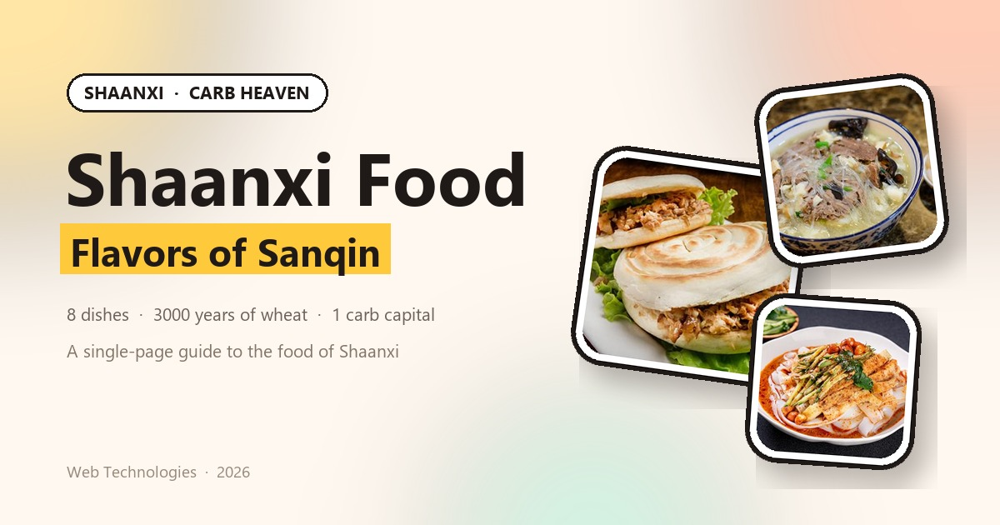

# Flavors of Sanqin · Shaanxi Food



A static single-page site about the food of Shaanxi — plain HTML, CSS and vanilla JavaScript. **No server, no framework, no build step**: double-click `index.html` and it runs, offline too.

**Live:** https://sagitt-45708.github.io/Shaanxi-food/
**Repo:** https://github.com/Sagitt-45708/Shaanxi-food

---

## What's on the page

| Section | Content |
| --- | --- |
| Header | Sticky nav; the active item follows the scroll |
| Hero | Headline, three floating dish cards, install button |
| Marquee | Pure-CSS scrolling band of dish names |
| Stats | 8 dishes · 3000 years · 50+ strokes · 1 carb capital |
| Food | Eight photo cards, filterable, each with a detail dialog |
| Culture | Tearing bread, the *biang* character, the Sanqin combo |
| One Day | Breakfast to midnight in Xi'an |
| Footer | Course credit, back to top |

Three interactions: **filter** by noodles / buns / snacks, a native `<dialog>` **detail pop-up**, and **add a dish** — pick a local photo, give it a name, and the card is saved in `localStorage` (image downscaled to 900px through `<canvas>` first).

## How to run it

Double-click `index.html`, or open the folder in VS Code and use Live Server. No external requests, no fonts or scripts from a CDN.

## Structure

```
shaanxi-food/
├── index.html            the page
├── manifest.webmanifest  PWA manifest
├── sw.js                 offline cache
├── css/style.css         all styles, 13 numbered sections
├── js/main.js            filter · dialog · add a dish · nav · install
├── images/               8 photos, icons, cover, favicon
└── README.md
```

## Editing

- **Text** — edit the copy in `index.html`.
- **Add a dish** — copy an `<article class="dish-card" data-cat="mo">…</article>` block, change `data-cat`, the name, the summary and the `<template>` detail.
- **Swap a photo** — overwrite the file in `images/` with the same filename; the CSS already handles the 4:3 crop.
- **Colours** — change the variables under `:root` in `css/style.css`; the whole site follows.

## Mobile

Below 960px the hero becomes single-column and the floating cards hide; below 600px the nav tightens, buttons go full-width and the grid becomes one column.

The site is a PWA: "Install on phone" in the hero (or the browser menu) adds it to the home screen, where it opens full-screen and works offline.

> After editing any page, bump `CACHE` in `sw.js` (`sanqin-v4` → `v5`), otherwise returning visitors keep the old copy.

## Git

Commits follow Conventional Commits — `feat:`, `style:`, `docs:`, `chore:` — one concern each, with a body explaining what changed and why.

```bash
git status
git add -A
git commit -m "feat: describe the change"
git push
```

## Credits

Written from public sources for a Web Technologies course project. Photos are used for coursework only, not for commercial purposes.
